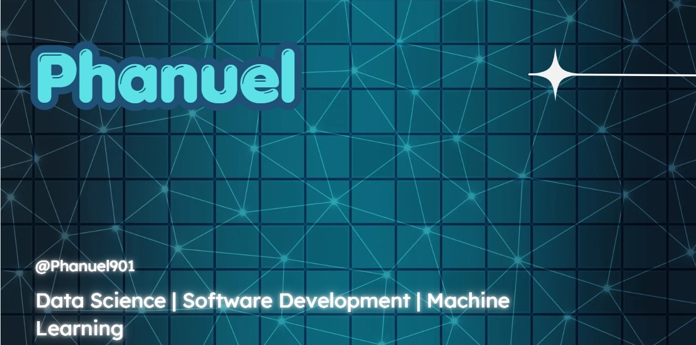

# Hi, I'm Phanuel 👋

### Data Science Student | Aspiring Software Engineer

Building projects, solving problems, and growing one commit at a time.

*Turning curiosity into code and ideas into reality.*

---

## 👨‍💻 About Me

I'm a Data Science student interested in the intersection of data, software development, and technology.

I enjoy learning how things work, experimenting with new tools, and building practical projects that solve real-world problems.

- 🎓 Studying Data Science.
- 💻 Learning Python, C++, and full-stack development.
- 📊 Exploring data analysis and machine learning.
- 🗄️ Learning database design and SQL with PostgreSQL.
- 🚀 Building projects to turn knowledge into practical skills.
- 🌱 Improving every day, one concept and one commit at a time.

## 🛠️ Technologies & Tools

### Languages

### Data Science & Machine Learning

### Web Development & Databases

### Developer Tools

## 🎯 Current Learning Goals

- Strengthening my Python and C++ fundamentals.
- Understanding databases, SQL, and data modelling.
- Building reliable applications with proper backend architecture.
- Learning data analysis and machine learning step by step.
- Writing cleaner, more maintainable code.

## 📈 My GitHub Activity

---

### Learn. Build. Improve.

*Every expert was once a beginner who kept going.*

### Contact
-GitHub: https://github.com/Phanuel901

-Email: agumphanuel901@gmail.com

-Whatsapp: +254140502234

